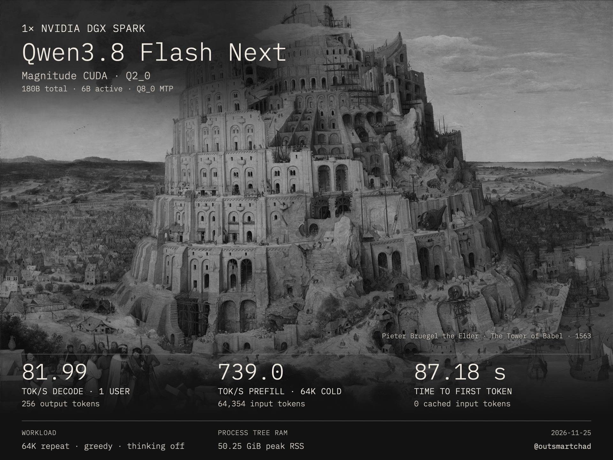

# Qwen3.8 Flash Next on one DGX Spark with Magnitude

Serve **180B total / 6B active** Qwen3.8 Flash Next on one 128 GB DGX Spark. The recipe uses Magnitude CUDA, ISTA-DASLab Q2_0 GGUF and the shared Q8_0 MTP head. The text API binds to `127.0.0.1`.



Artwork by Pieter Bruegel the Elder, *The Tower of Babel* (1563). [Source](<https://commons.wikimedia.org/wiki/File:Pieter_Bruegel_the_Elder_-_The_Tower_of_Babel_(Vienna)_-_Google_Art_Project.jpg>)

[Setup and first chat](docs/setup.md) · [How it works](docs/how-it-works.md) · [Benchmark method and raw data](docs/results.md) · [Troubleshooting](docs/troubleshooting.md)

## Performance

Measured November 25, 2026 with one request at a time, a cold 64K text repeat prompt, 256 output tokens, greedy sampling and thinking off.

| Pass | Decode tok/s | Prefill tok/s | TTFT |
| --- | ---: | ---: | ---: |
| 1 | 81.99 | 739.0 | 87.18 s |
| 2 | 63.88 | 743.6 | 86.65 s |
| Median | 72.94 | 741.3 | 86.92 s |

The card pairs the fastest valid decode pass with its prefill and TTFT. Peak sampled process-tree RSS was **50.25 GiB**. See [the full report](docs/results.md) for actual token counts, tuning, cache state and individual draft counters. These figures belong to the 64K repeat workload. The earlier [Q4 prose and 32K/128K results](docs/results.md#earlier-local-chat-run-with-q4) are recorded separately.

## Run it on your Spark

Install [the prerequisites](docs/setup.md#1-check-the-spark) and pause other loaded inference models before serving. Allow about **100 GB** free on SSD for the model, source builds and caches.

```bash
git clone https://github.com/outsmartchad/qwen38-flash-next-single-dgx-spark-magnitude.git
cd qwen38-flash-next-single-dgx-spark-magnitude
./scripts/recipe.py doctor
./scripts/recipe.py prepare
./scripts/recipe.py serve
```

When the serving URL appears, open a second Spark terminal in the checkout and run:

```bash
./scripts/recipe.py smoke
```

Expected reply: `SPARK_OK`. The OpenAI-compatible base URL is `http://127.0.0.1:10100/v1` and the model ID is `qwen3.8-flash-next:gguf:q2`. Setup pins the [source](https://github.com/magnitudedev/magnitude/tree/78c92e4f21e38f9528f21e09c5e43936a04b6b0d), [checkpoint](https://huggingface.co/ISTA-DASLab/Qwen3.8-Flash-Next-GSQ-RCO-GGUF/tree/ed59f92082b1e93c0e96d60a8b11aab089b52f09) and CUDA runtime compiler. See [setup](docs/setup.md) for a full API request.

Stop serving with Ctrl-C before starting the measured benchmark.

```bash
./scripts/benchmark.sh
```

[Upstream Magnitude](https://github.com/magnitudedev/magnitude) · [Original model card](https://huggingface.co/Qwen/Qwen3.8-Flash-Next)
